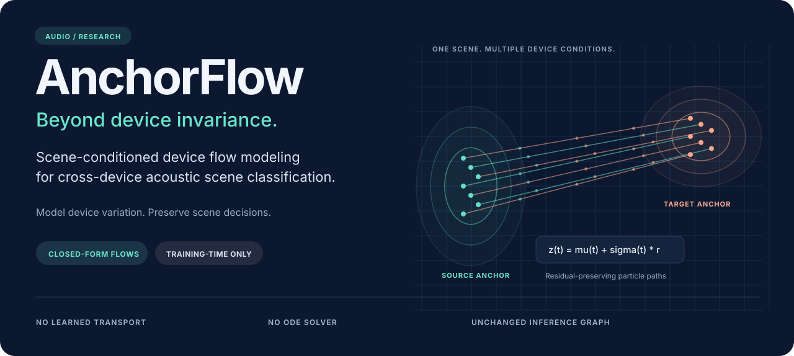
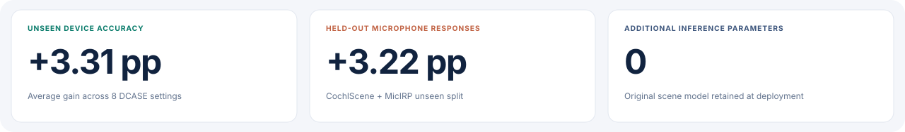
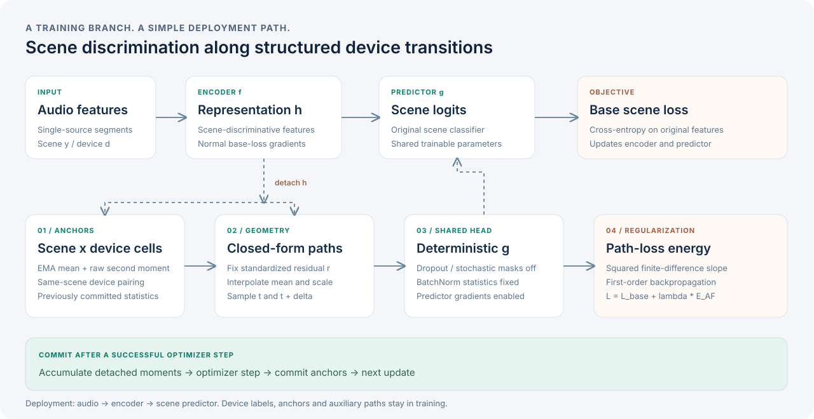
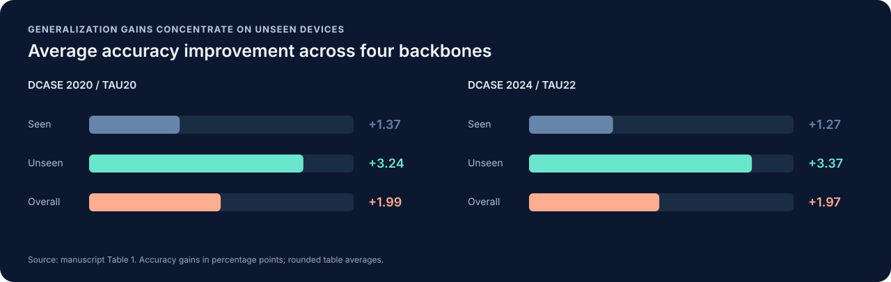

<div align="center">



### Beyond Device Invariance: Scene-Conditioned Device Flow Modeling<br>for Cross-Device Acoustic Scene Classification

**Peihong Zhang · Yuxuan Liu · Yiqiang Cai · Yizhou Tan · Shengchen Li**  
Academy of Artificial Intelligence and Advanced Technology  
Xi'an Jiaotong-Liverpool University

[**Paper**](docs/paper.pdf) · [**Method**](docs/method.md) · [**Results**](docs/results.md) · [**Integration**](docs/integration.md) · [**中文**](README.zh-CN.md)

**PyTorch** &nbsp; / &nbsp; **Closed-form transport** &nbsp; / &nbsp; **Training-time regularization**

</div>

<br>



## Device variation carries structure

Recording devices change how acoustic cues are observed, and the change depends on
the scene. Suppressing every trace of device information can also weaken cues needed
to distinguish an airport from a metro station or a park from a public square.

**AnchorFlow models this variation inside each scene.** Distributional anchors
describe observed scene-device conditions. Closed-form paths connect those anchors
while preserving each sample's standardized residual. A path regularizer encourages
the scene predictor to remain stable along the resulting device transitions.

Device labels are required during training. Deployment keeps the original encoder
and scene predictor.

| Design | Mechanism | Why it matters |
| :--- | :--- | :--- |
| **Scene-conditioned anchors** | EMA first and second moments for each scene-device cell | Device effects can differ between scenes |
| **Residual-preserving flows** | Coordinate-wise Gaussian transport with explicit paths and velocities | Retains sample-specific structure without an ODE solver |
| **Path-loss regularization** | Squared finite differences of scene loss | Uses ordinary first-order backpropagation |
| **Detached geometry** | Gradients from the auxiliary branch update the shared predictor | Keeps the regularizer from reshaping features to reduce its own energy |

## The method at a glance



For a source anchor $(\mu_s,\sigma_s)$ and a same-scene target anchor
$(\mu_t,\sigma_t)$, retain the sample residual and interpolate the statistics:

$$
r_i=\frac{\operatorname{sg}(h_i)-\mu_s}{\sigma_s},\qquad
z_i(\tau)=\big[(1-\tau)\mu_s+\tau\mu_t\big]
+\big[(1-\tau)\sigma_s+\tau\sigma_t\big]\odot r_i.
$$

The auxiliary head shares the scene predictor's parameters, with stochastic masking
disabled and BatchNorm statistics fixed:

$$
\mathcal{L}=\mathcal{L}_{\mathrm{base}}+
\lambda_{\mathrm{AF}}\,\mathbb{E}\!\left[
\left(\frac{\ell(g_\phi^{\mathrm{aux}}(z_i(\tau+\delta)),y_i)
-\ell(g_\phi^{\mathrm{aux}}(z_i(\tau)),y_i)}{\delta}\right)^2\right].
$$

[Read the derivation and gradient behavior →](docs/method.md)

## Results from the paper

The following results are reported in the [accompanying manuscript](docs/paper.pdf),
Table 1, over five runs. Accuracy is shown as mean ± standard deviation; gains are
percentage points. Structured source tables are in [`benchmarks/`](benchmarks).



**DCASE 2020 Task 1A · TAU20**

| Backbone | Unseen · Base | Unseen · +AF | Gain | Overall · Base | Overall · +AF |
| :--- | ---: | ---: | ---: | ---: | ---: |
| CP-Mobile | 66.57 ± 0.57 | **69.70 ± 0.61** | +3.13 | 72.00 ± 0.39 | **73.93 ± 0.36** |
| BC-ResNet-ASC-8 | 64.34 ± 0.52 | **67.78 ± 0.55** | +3.44 | 69.51 ± 0.39 | **71.64 ± 0.39** |
| TF-SepNet-64 | 64.14 ± 0.52 | **67.85 ± 0.57** | +3.71 | 70.32 ± 0.27 | **72.63 ± 0.31** |
| PaSST-S | 74.34 ± 0.65 | **77.02 ± 0.60** | +2.68 | 75.67 ± 0.51 | **77.28 ± 0.48** |

**DCASE 2024 Task 1 · TAU22 split100**

| Backbone | Unseen · Base | Unseen · +AF | Gain | Overall · Base | Overall · +AF |
| :--- | ---: | ---: | ---: | ---: | ---: |
| CP-Mobile | 53.10 ± 0.58 | **56.37 ± 0.55** | +3.27 | 60.63 ± 0.47 | **62.55 ± 0.38** |
| BC-ResNet-ASC-8 | 52.00 ± 0.50 | **55.57 ± 0.57** | +3.57 | 59.40 ± 0.35 | **61.50 ± 0.34** |
| TF-SepNet-64 | 53.70 ± 0.49 | **57.62 ± 0.58** | +3.92 | 61.10 ± 0.24 | **63.42 ± 0.28** |
| PaSST-S | 55.90 ± 0.48 | **58.62 ± 0.59** | +2.72 | 60.23 ± 0.26 | **61.78 ± 0.25** |

On **CochlScene + MicIRP**, the paper reports unseen-response accuracy improving
from **65.22 ± 0.60** to **68.44 ± 0.56**. AnchorFlow also combines with RFN,
Freq-MS and DIR; the full comparisons and ablations are in [Results](docs/results.md).

## Get started

Use Python 3.11+ and install the package in editable mode. Install the PyTorch build
appropriate for your hardware before adding optional audio dependencies.

```bash
python -m pip install -e .
# Optional waveform-to-log-mel preparation
python -m pip install -e '.[audio]'
```

### 1. Prepare device-aware data

Each manifest row describes one cached 1-second log-mel segment. Store features as
float32 NumPy arrays of shape `[mel_bins, frames]` or `[1, mel_bins, frames]`.

```csv
feature_path,scene,device,recording_id,user_id
features/airport_A_0001.npy,airport,A,airport_0001,
features/park_B_0002.npy,park,B,park_0002,
```

```bash
anchorflow validate-data --manifest data/train.csv \
  --protocol configs/protocols/dcase2024.yaml --source-only
```

[Data preparation and protocol details →](docs/data.md)

### 2. Train with scene-conditioned flows

```bash
anchorflow train --config configs/default.yaml \
  --protocol configs/protocols/dcase2024.yaml \
  --train-csv data/train.csv --val-csv data/val_source.csv \
  --feature-root data --output runs/tau22_af_seed0 --device cuda --seed 0
```

Choose an encoder/head boundary through `model.factory` in the configuration.
`CompactASC` provides a small convolutional integration model. Existing ASC systems
can attach the regularizer directly to their selected representation:

```python
from anchorflow import AnchorFlow

af = AnchorFlow(num_scenes=10, num_devices=6, feature_dim=128).to(device)

h = encoder(x)
base_loss = scene_loss(head(h), y)
flow = af(h, y, d, head=head, epoch=epoch)
loss = base_loss + af.config.weight * flow.energy

af.bank.stage(h, y, d)
loss.backward()
optimizer.step()
af.bank.commit()  # Current paths used the previous committed anchor state.
```

Keep the surrounding training loop's gradient reset and error handling. The complete
pattern is in [`examples/integrate.py`](examples/integrate.py).

### 3. Evaluate and export the scene model

```bash
anchorflow evaluate --checkpoint runs/tau22_af_seed0/best.pt \
  --manifest data/eval.csv --feature-root data --device cuda

anchorflow export --checkpoint runs/tau22_af_seed0/best.pt \
  --output checkpoints/scene_model.pt
```

Evaluation reports overall, seen-device, unseen-device and per-device accuracy.
For TAU20, ten segment probabilities are averaged before recording-level prediction.
Export retains the encoder and predictor weights without anchor or optimizer state.

## Built around the training lifecycle

| Component | Engineering detail |
| :--- | :--- |
| Anchor bank | Float32 moment buffers, cumulative eligibility counts and first-observation initialization |
| Effective updates | Accumulate microbatch statistics, then commit or discard the entire update |
| Auxiliary head | Restores every module's original mode after deterministic evaluation |
| Distribution | Optional all-reduce of anchor sufficient statistics through `bank.commit(synchronize=True)` |
| Selection | Source-only validation with recording and user leakage checks |
| Checkpoints | Model, anchor state, optimizer, scheduler and Torch/DataLoader RNG state |
| Deployment | Scene model export containing no training branch |

The command-line trainer uses a single device. Distributed integration and gradient
accumulation follow the lifecycle described in [Integration](docs/integration.md).

```text
AnchorFlow_ICASSP2027/
├── src/anchorflow/       # Anchors, flows, regularizer, models, data and trainer
├── configs/             # Method defaults and DCASE protocol definitions
├── examples/            # Device-aware manifest and integration pattern
├── benchmarks/          # Structured tables from the paper
├── docs/                # Paper, derivation, results, integration and SVG assets
├── tests/               # Geometry, gradient, anchor and data invariants
├── tools/               # Audio preparation, artwork and repository checks
└── .github/             # Quality workflow and contribution templates
```

## Citation

```bibtex
@unpublished{zhang_anchorflow,
  title  = {Beyond Device Invariance: Scene-Conditioned Device Flow Modeling
            for Cross-Device Acoustic Scene Classification},
  author = {Zhang, Peihong and Liu, Yuxuan and Cai, Yiqiang and
            Tan, Yizhou and Li, Shengchen},
  note   = {Research manuscript}
}
```

## License

Code is distributed under the [MIT License](LICENSE). The manuscript and third-party
datasets retain their respective rights. See [Contributing](CONTRIBUTING.md) for
development conventions.
