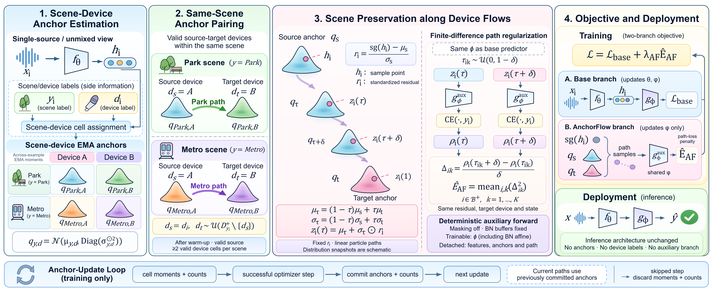
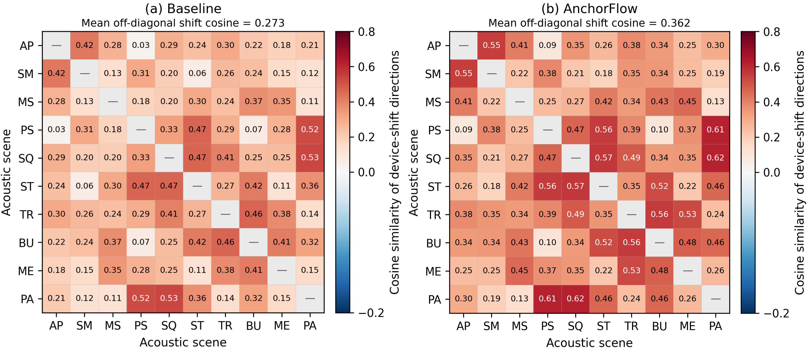

<div align="center">

<h1>AnchorFlow</h1>
<h3>Beyond Device Invariance: Scene-Conditioned Device Flow Modeling<br>for Cross-Device Acoustic Scene Classification</h3>

<p>
  <a href="docs/paper.pdf"></a>
  <a href="docs/method.md"></a>
  <a href="LICENSE"></a>
</p>

[Peihong Zhang](https://orcid.org/0009-0002-9561-1412),
[Yuxuan Liu](https://orcid.org/0009-0007-1043-416X),
[Yiqiang Cai](https://orcid.org/0009-0004-7062-7850),
[Yizhou Tan](https://orcid.org/0000-0002-4103-8115),
[Shengchen Li](https://orcid.org/0000-0002-2488-298X)

Xi'an Jiaotong-Liverpool University

[English](README.md) / [简体中文](README.zh-CN.md)

</div>

[](docs/figures/method.png)

<p align="center"><em>Scene-conditioned anchors and residual-preserving device flows. Overview from the paper.</em></p>

> **TL;DR** AnchorFlow uses scene-conditioned device variation as a training signal.
> Closed-form paths connect same-scene device distributions, and a finite-difference
> loss regularizes scene prediction along those paths. The inference model is unchanged.

<p align="center">
  <a href="#quick-start">Quick start</a> &nbsp;·&nbsp;
  <a href="#results">Results</a> &nbsp;·&nbsp;
  <a href="docs/integration.md">Training integration</a> &nbsp;·&nbsp;
  <a href="#citation">Citation</a>
</p>

## Quick start

Use Python 3.11+ and install the PyTorch build for your hardware.

```bash
git clone https://github.com/manifold112/AnchorFlow_ICASSP2027.git
cd AnchorFlow_ICASSP2027
python -m pip install -e .
```

Prepare one-second log-mel features and device-aware CSV manifests using the
[data guide](docs/data.md), then train:

```bash
anchorflow train --config configs/default.yaml \
  --protocol configs/protocols/dcase2024.yaml \
  --train-csv data/train.csv --val-csv data/val_source.csv \
  --feature-root data --output runs/tau22_af_seed0 --device cuda --seed 0
```

The [configuration](configs/default.yaml) contains the paper's AnchorFlow
parameters. Keep the backbone, optimizer and preprocessing matched between
baseline and AnchorFlow runs. Source-only validation uses observed devices
A-C and S1-S3; S4-S6 are reserved for unseen-device evaluation.

<details>
<summary><b>Evaluation and model export</b></summary>

```bash
anchorflow evaluate --checkpoint runs/tau22_af_seed0/best.pt \
  --manifest data/eval.csv --feature-root data --device cuda

anchorflow export --checkpoint runs/tau22_af_seed0/best.pt \
  --output checkpoints/scene_model.pt
```

TAU20 averages the probabilities of ten one-second segments before predicting the
recording label. Export retains the encoder and scene predictor, without the
anchor bank or optimizer state.

</details>

<details>
<summary><b>Attach AnchorFlow to an existing classifier</b></summary>

Expose an encoder producing `[batch, feature_dim]` and a scene head consuming those
features. The regularizer shares the head's trainable parameters:

```python
from anchorflow import AnchorFlow

af = AnchorFlow(num_scenes=10, num_devices=6, feature_dim=128).to(device)
h = encoder(x)
base_loss = criterion(head(h), y)
flow = af(h, y, d, head=head, epoch=epoch)
loss = base_loss + af.config.weight * flow.energy
```

Stage detached moments before backpropagation, and commit them only after a
successful optimizer step. The complete update is in
[`examples/integrate.py`](examples/integrate.py); the
[integration guide](docs/integration.md) covers head state, gradient accumulation
and distributed anchor statistics.

</details>

## Results

**Unseen-device accuracy (%)**, reported in Table 1 of the paper as mean ± standard
deviation over five runs. TAU20: DCASE 2020 Task 1A. TAU22: DCASE 2024 Task 1 split100.

| Backbone | TAU20 | TAU20 + AF | TAU22 | TAU22 + AF |
| :--- | ---: | ---: | ---: | ---: |
| CP-Mobile | 66.57 ± 0.57 | **69.70 ± 0.61** | 53.10 ± 0.58 | **56.37 ± 0.55** |
| BC-ResNet-ASC-8 | 64.34 ± 0.52 | **67.78 ± 0.55** | 52.00 ± 0.50 | **55.57 ± 0.57** |
| TF-SepNet-64 | 64.14 ± 0.52 | **67.85 ± 0.57** | 53.70 ± 0.49 | **57.62 ± 0.58** |
| PaSST-S | 74.34 ± 0.65 | **77.02 ± 0.60** | 55.90 ± 0.48 | **58.62 ± 0.59** |

AnchorFlow improves unseen-device accuracy by an average of **3.31 percentage
points** across the eight settings. On CochlScene + MicIRP, accuracy under held-out
microphone responses increases from 65.22 ± 0.60 to **68.44 ± 0.56**.

[](docs/figures/device-shifts.png)

<p align="center"><em>Cross-scene device-shift similarity: baseline (left) and AnchorFlow (right). Figure 3 from the paper.</em></p>

[Full results and ablations](docs/results.md) · [CSV tables](benchmarks) · [Method and equations](docs/method.md)

## Citation

```bibtex
@unpublished{zhang_anchorflow,
  title  = {Beyond Device Invariance: Scene-Conditioned Device Flow Modeling
            for Cross-Device Acoustic Scene Classification},
  author = {Zhang, Peihong and Liu, Yuxuan and Cai, Yiqiang and
            Tan, Yizhou and Li, Shengchen},
  note   = {Research manuscript}
}
```

Code is released under the [MIT License](LICENSE). The paper and third-party
datasets retain their respective rights.
