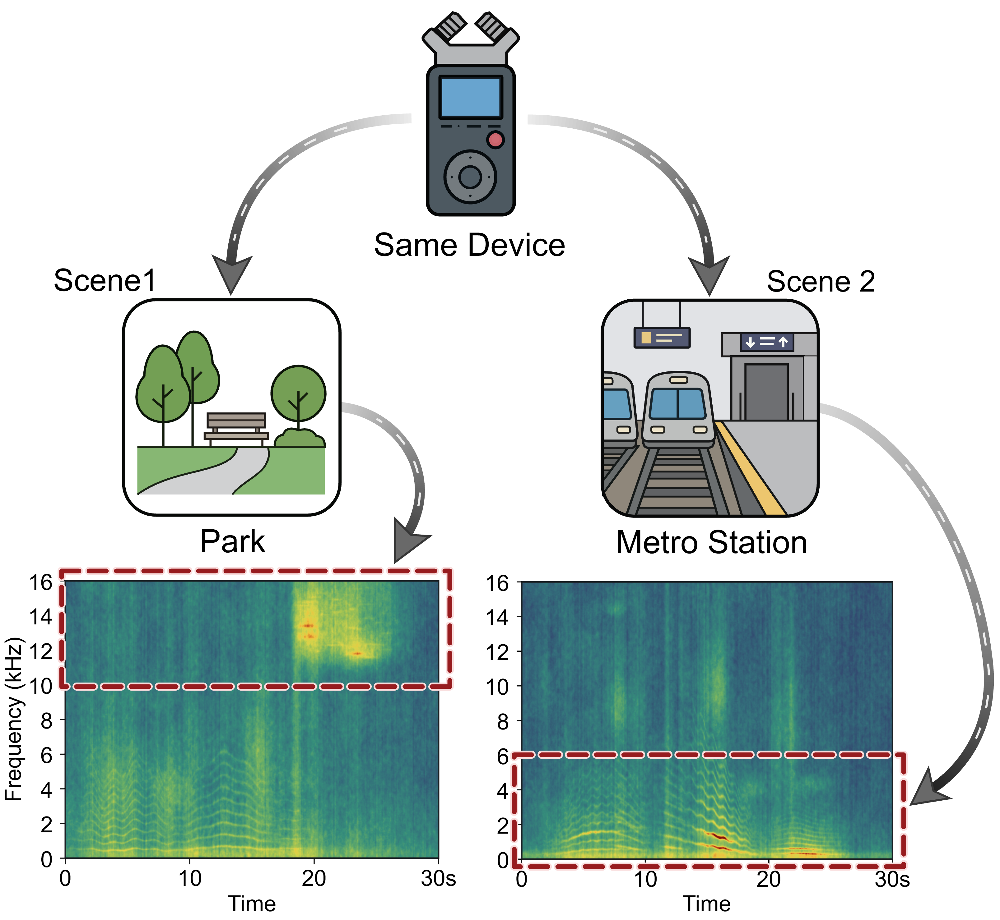

# Scene-conditioned device flows

[← Project](../README.md) · [Integration](integration.md) · [Paper](paper.pdf)

AnchorFlow splits an acoustic scene classifier into a selected representation
$h=f_\theta(x)$ and the remaining predictor $g_\phi(h)$. The original training
objective remains $\mathcal{L}_{\mathrm{base}}$.

The motivation is that device effects depend on the acoustic scene:

<p align="center">
  
</p>

*Figure 1 from the paper. A device change affects scene-relevant cues differently
across scenes.*

## 1. Joint scene-device anchors

Each observed cell $(y,d)$ has a diagonal-Gaussian approximation:

```math
q_{y,d}=\mathcal{N}(\mu_{y,d},\mathrm{Diag}(\sigma_{y,d}^{\odot 2})).
```

Accumulate detached first and second raw moments over an effective optimizer
update. For a nonempty cell, initialize its moments directly on first observation;
otherwise update them using EMA decay $\beta$:

```math
m_{y,d}^{(r)}\leftarrow\beta m_{y,d}^{(r)}+
(1-\beta)\frac{1}{c_{y,d}}\sum_{i\in I_{y,d}}
\mathrm{sg}(h_i)^{\odot r},\quad r\in\{1,2\}.
```

```math
\mu=m^{(1)},\qquad
\sigma=\sqrt{\max(m^{(2)}-\mu^{\odot 2},\nu_{\min})+\epsilon}.
```

The bank stores raw moments, rather than independently averaging minibatch
variances. Counts accumulate across successful updates. A source anchor needs at
least $n_{\min}$ observations, and at least one other valid device must exist in
the same scene.

**Update timing:** paths use the previously committed bank. Feature moments are
staged during the update and committed after the optimizer step succeeds.

Implementation: [`AnchorBank`](../src/anchorflow/anchors.py).

## 2. Residual-preserving transport

Sample a target uniformly from eligible devices in the same scene, excluding the
source. Source and target recordings need not be paired. With source and target
statistics $(\mu_s,\sigma_s)$ and $(\mu_t,\sigma_t)$, define:

```math
r_i=(\mathrm{sg}(h_i)-\mu_s)\oslash\sigma_s,
```

```math
\mu_\tau=(1-\tau)\mu_s+\tau\mu_t,\quad
\sigma_\tau=(1-\tau)\sigma_s+\tau\sigma_t,\quad
z_i(\tau)=\mu_\tau+\sigma_\tau\odot r_i.
```

These statistics follow the 2-Wasserstein geodesic between diagonal Gaussians.
Each particle follows a linear path whose velocity is available explicitly:

```math
v_i=\mu_t-\mu_s+(\sigma_t-\sigma_s)\odot r_i.
```

The endpoint $z_i(0)$ equals the detached feature. The target endpoint retains the
same standardized residual in the target anchor. No transport network or numerical
ODE integration is required.

Implementation: [`DeviceFlow`](../src/anchorflow/flows.py).

## 3. Scene-loss path energy

Evaluate the shared predictor deterministically on a path:

```math
\rho_i(\tau)=\ell_{\mathrm{CE}}(g_\phi^{\mathrm{aux}}(z_i(\tau)),y_i).
```

The continuous energy is $\mathbb{E}[\int_0^1(\rho_i'(\tau))^2d\tau]$.
By Cauchy-Schwarz, this energy bounds the squared change in scene loss between
the two endpoints. It controls the scene-loss response to modeled device changes;
it does not require every class probability to remain identical.

Draw $K$ same-scene targets per eligible sample, with replacement, and sample
$\tau\sim\mathcal{U}(0,1-\delta)$. Estimate each directional loss slope with:

```math
\Delta_{ik}=\frac{\rho_i(\tau_{ik}+\delta)-\rho_i(\tau_{ik})}{\delta},\qquad
\widehat{\mathcal{E}}_{\mathrm{AF}}=
\frac{1}{|B^+|K}\sum_{i\in B^+}\sum_{k=1}^K\Delta_{ik}^2.
```

The two evaluations share the residual, target device and auxiliary predictor
state. The energy is zero when there are no eligible samples or during warm-up.
The objective uses ordinary first-order backpropagation; it never differentiates
a directional gradient to form a higher-order objective.

Implementation: [`AnchorFlow`](../src/anchorflow/regularizer.py).

## 4. Gradient boundary and deterministic evaluation

Features, anchors and path geometry are detached. The auxiliary predictor shares
trainable parameters with the original head:

```math
\nabla_\theta\mathcal{L}=\nabla_\theta\mathcal{L}_{\mathrm{base}},\qquad
\nabla_\phi\mathcal{L}=\nabla_\phi\mathcal{L}_{\mathrm{base}}+
\lambda_{\mathrm{AF}}\nabla_\phi\widehat{\mathcal{E}}_{\mathrm{AF}}.
```

The auxiliary call uses evaluation mode to disable dropout and to freeze BatchNorm
running statistics, while autograd remains enabled for predictor parameters,
including affine normalization parameters. Each module's prior training mode is
restored afterward. Custom masking or patchout modules must respect their
`training` flag.

At inference, evaluate $g_\phi(f_\theta(x))$ directly. The anchor bank and flow
branch do not participate.

## Manuscript parameters

| Parameter | Value | Configuration key |
| :--- | ---: | :--- |
| $\lambda_{\mathrm{AF}}$ | 0.3 | `weight` |
| $\delta$ | 0.20 | `delta` |
| $K$ | 1 | `targets_per_sample` |
| $\beta$ | 0.99 | `ema_decay` |
| $n_{\min}$ | 32 | `min_samples` |
| $\nu_{\min}$ | 1e-6 | `variance_floor` |
| $\epsilon$ | 1e-5 | `epsilon` |
| Warm-up | 1 epoch | `warmup_epochs` |

The values above are specified in the manuscript. Optimizer, front-end and backbone
configuration are experiment choices; retain the same choices in matched baseline
and AnchorFlow runs.
